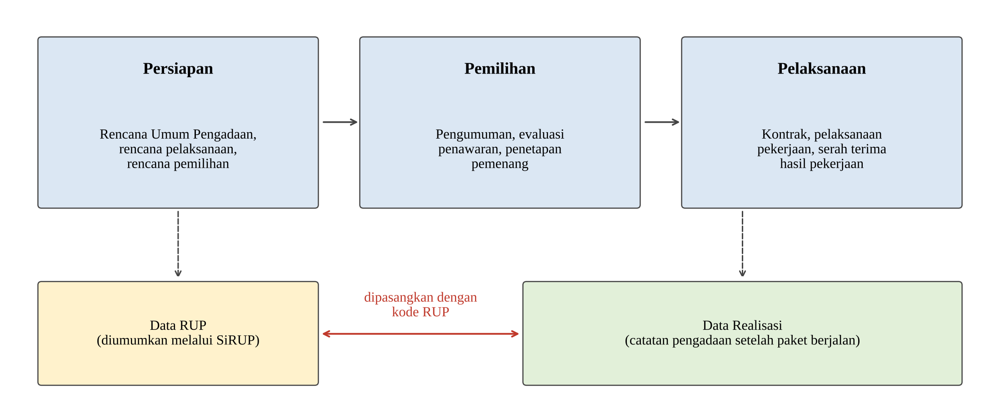

<!-- Bab 2.2.2 v1 (31 Oktober 2026), untuk tab "SKRIPSI TIO DRAFT" di Google Doc SKRIPSI TIO.
Gaya: umum, tanpa rujukan subbab, sitasi pasal lengkap (APA 7: nama peraturan, tahun, pasal).
Sumber pasal (dicek ke Konsolidasi-Perpres-PBJ-16-2018-12-2021-46-2025.pdf): Pasal 1 angka 19 (definisi RUP).
Perpres hanya dipakai sekali (permintaan Tio); tahap persiapan dan pelaksanaan dari Kusumadewi et al. (2022), hlm. 103 dan 110.
LKPP (2025a, 2025b) dan Kusumadewi et al. (2022) sudah ada di Daftar Pustaka.
Gambar: bab2/gambar-v3/gambar-2-1-tahapan-pengadaan.png (sudah disisipkan ke Google Doc). -->

### 2.2.2 Rencana Umum Pengadaan dan Realisasi Pengadaan

Rencana Umum Pengadaan (RUP) adalah daftar rencana pengadaan barang/jasa yang akan dilaksanakan oleh kementerian, lembaga, atau perangkat daerah (Peraturan Presiden Nomor 46 Tahun 2025, 2025, Pasal 1 angka 19). RUP disusun pada tahap persiapan pengadaan, bersama dengan rencana pelaksanaan pengadaan dan rencana pemilihan penyedia (Kusumadewi et al., 2022). RUP kemudian diumumkan melalui Sistem Informasi Rencana Umum Pengadaan (SiRUP) agar rencana pengadaan dapat diketahui oleh publik (LKPP, 2025a).

Setelah penyedia terpilih, kontrak ditandatangani secara elektronik dan pelaksanaan pengadaan dipantau melalui sistem (Kusumadewi et al., 2022). Catatan pelaksanaan tersebut menjadi data realisasi, yang memuat antara lain penyedia terpilih dan nilai transaksi setiap paket. Data RUP dan data realisasi tersedia secara terbuka melalui portal Data INAPROC (LKPP, 2025b).

Dalam tugas akhir ini, data RUP digunakan untuk menilai paket pada tahap perencanaan, sedangkan data realisasi digunakan untuk menilai paket setelah berjalan. Kedua data dihubungkan melalui kode RUP yang sama, sehingga rencana dan pelaksanaan satu paket dapat dibandingkan. Hubungan tersebut ditunjukkan pada Gambar 2.1.

Gambar 2.1 Hubungan Tahapan Pengadaan dengan Data RUP dan Data Realisasi (diadaptasi dari Kusumadewi et al., 2022)

