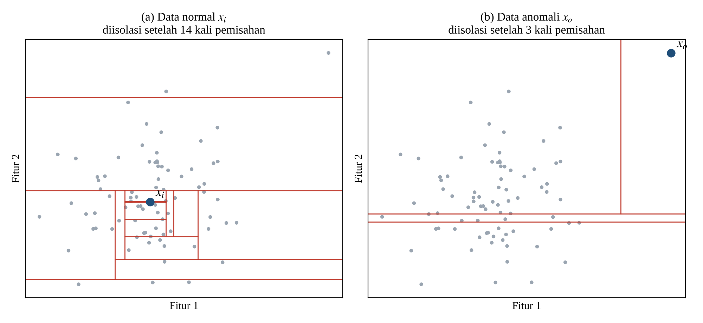
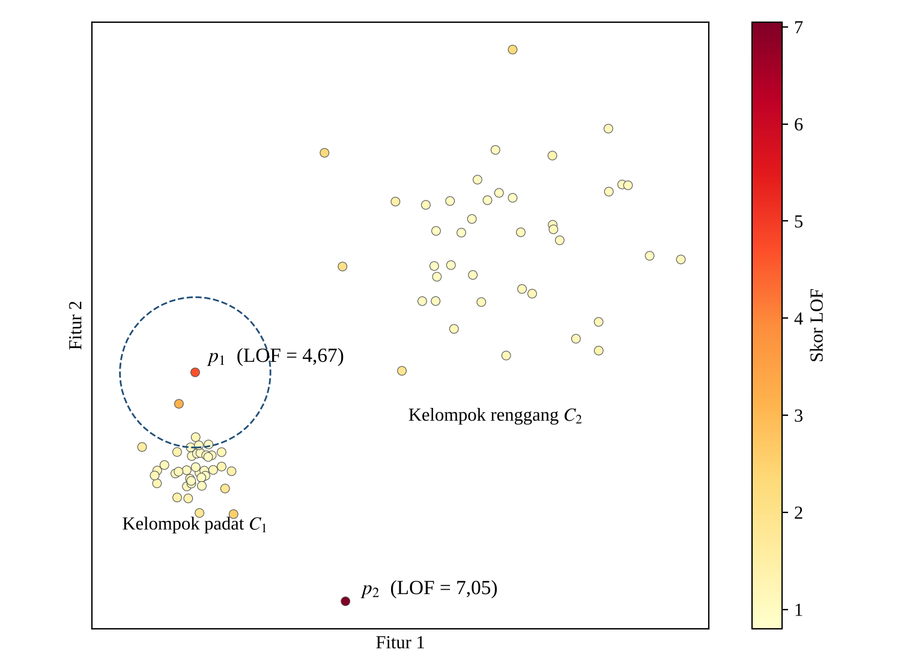
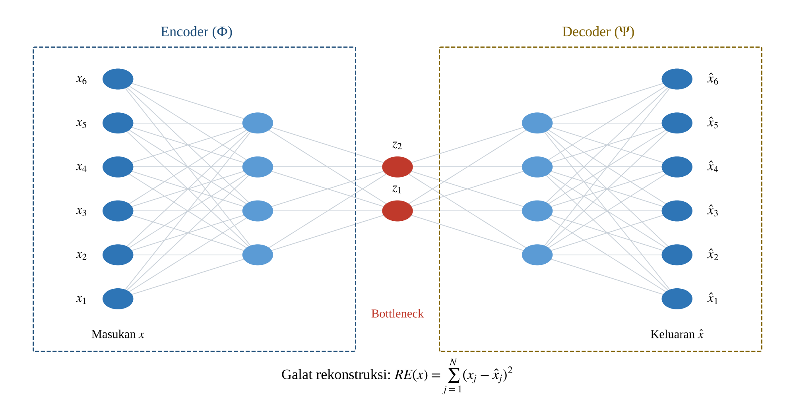
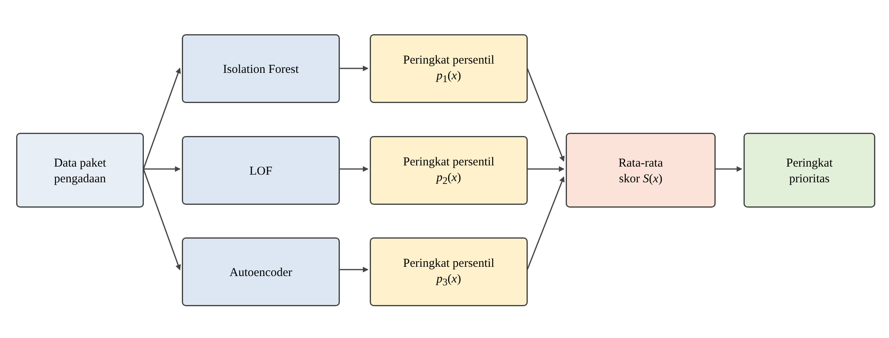
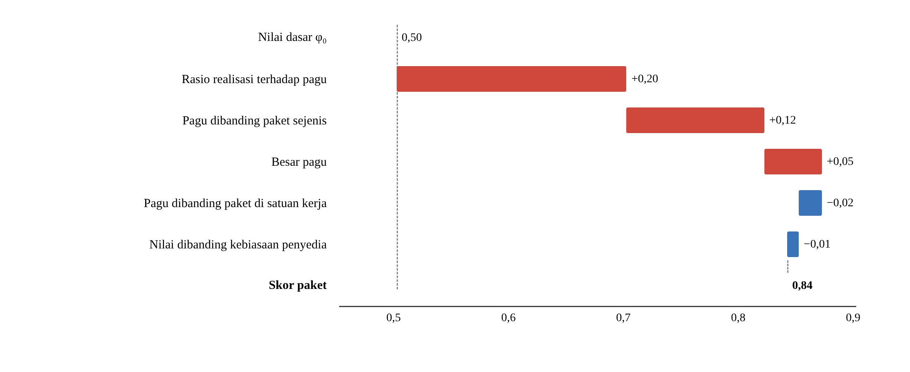
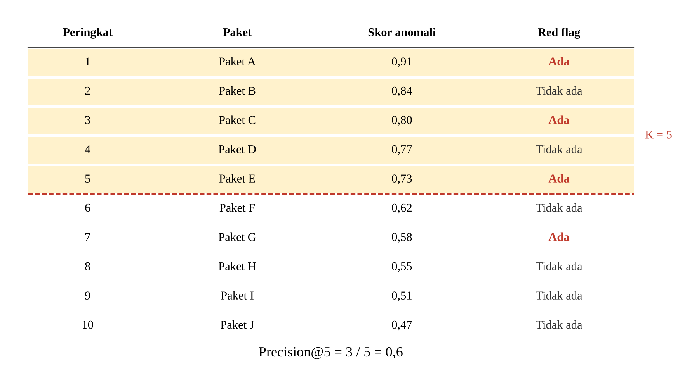

<!-- Bab 2.2.4 sampai 2.2.12 v1 (1 November 2026), untuk tab "SKRIPSI TIO DRAFT" di Google Doc SKRIPSI TIO.
Dasar: tab "Bab 2 v.4" (bab2/dasar-teori-v3.md), disesuaikan dengan model-v5 versi 31 Okt dan gaya penulisan Tio
(umum, tanpa rujukan subbab, istilah asing dicetak miring).
Penomoran: Gambar 2.1 di 2.2.2 dihapus, jadi gambar mulai dari 2.1. Tabel 2.2 dipakai di 2.2.1, jadi tabel metrik = Tabel 2.3.
Gambar: bab2/gambar-v4/. Gambar 2.4 (ensemble persentil) dan 2.5 (contoh SHAP) dibuat ulang; sumber HTML di gambar-v4/sumber/.
Klaim yang dicek ke PDF di repo: Han et al. (2022) (supervised/semi/unsupervised, empat jenis anomali, anomali sintetis
disisipkan ke data nyata), Schneider dos Santos et al. (2025) (data tidak berlabel), Herreros-Martinez et al. (2025)
(100 pohon, subsampel 256), Krcmar et al. (2026) (min-max), Antwarg et al. (2021) (penjelasan diuji dengan mengganti nilai
fitur dengan rata-rata). Alghushairy et al. (2021) dan Michelucci (2022) tidak ada PDF-nya di repo; isinya diambil dari v.4.
[PERLU RUJUKAN] untuk normalisasi peringkat persentil: belum ada sumber di repo; situs jurnal diblokir dari sesi ini.
2.2.4 diparafrase (3 Nov 2026): definisi ML dari Schneider dos Santos et al. (2025) Bagian 4.2.1; klaim "sebagian besar penelitian memakai ML" diganti "salah satu pendekatan utama" (hanya 26 dari 93 studi yang memakai ML saja); contoh semi-supervised disesuaikan dengan Han et al. (2022).
2.2.4 diganti versi tulisan Tio (3 Nov 2026) + sitasi di tiap definisi. Catatan: Han et al. (2022) MEMANG menyebut semi-supervised yang dilatih hanya pada data normal ("some semi-supervised models are trained only on normal samples"), jadi contoh itu sah.
2.2.4 asumsi unsupervised (3 Nov 2026): ditambah Herreros-Martinez et al. (2025) (low-density areas, low probability of occurrence), Schiavon et al. (2026) (performance is dataset-dependent), Krcmar et al. (2026) (no single detector universally superior); semua dicek ke PDF.
2.2.5 versi final Tio (3 Nov 2026); istilah asing dimiringkan di Google Doc.
2.2.6 ditulis ulang (3 Nov 2026) lebih sederhana tanpa rumus; rujukan Zulfikar et al. (2023), Ambarsari et al. (2025), Herreros-Martinez et al. (2025), Schiavon et al. (2026), semua dicek ke PDF. Persamaan dinomori ulang menjadi (2.1)-(2.13).
Sudah dimasukkan ke tab "SKRIPSI TIO DRAFT" (1 Nov 2026), termasuk Gambar 2.1-2.6 dan Tabel 2.3; teks dicek sama persis (77 paragraf). -->

### 2.2.4 *Machine Learning* dan *Unsupervised Learning*

*Machine learning* merupakan metode yang memungkinkan komputer mengidentifikasi dan mempelajari pola berdasarkan data yang tersedia (Schneider dos Santos et al., 2025). Pendekatan ini telah banyak diterapkan dalam penelitian terkait deteksi penyimpangan pada pengadaan (Schneider dos Santos et al., 2025). Berdasarkan ketersediaan label pada data, metode *machine learning* dalam deteksi anomali dapat dikategorikan menjadi tiga pendekatan, yaitu *supervised learning*, *semi-supervised learning*, dan *unsupervised learning* (Han et al., 2022).

Pada pendekatan supervised learning, deteksi anomali diperlakukan sebagai permasalahan klasifikasi biner yang membedakan data normal dan anomali. Pendekatan ini membutuhkan data berlabel dalam jumlah yang memadai, sedangkan ketersediaan label tersebut sering kali terbatas. Selain itu, model berpotensi tidak mampu mengenali pola anomali baru yang belum tercakup dalam data pelatihan (Han et al., 2022).* Semi-supervised learning* cukup menggunakan sebagian data berlabel, misalnya dengan melatih model hanya pada data normal (Han et al., 2022). Sementara itu, *unsupervised learning* tidak membutuhkan label sama sekali (Han et al., 2022). Pendekatan ini mendeteksi anomali berdasarkan asumsi tertentu tentang karakteristik data, misalnya bahwa data yang menyimpang berada di daerah dengan kepadatan rendah atau memiliki peluang kemunculan yang kecil dibandingkan data lainnya (Han et al., 2022; Herreros-Martínez et al., 2025). Oleh sebab itu, kemampuan metode ini dalam mendeteksi anomali ditentukan oleh kesesuaian asumsi tersebut dengan karakteristik data yang dianalisis, sehingga tidak ada satu metode yang selalu unggul pada semua data (Han et al., 2022; Krčmar et al., 2026; Schiavon et al., 2026).

Penelitian ini menerapkan pendekatan *unsupervised learning* karena data Rencana Umum Pengadaan (RUP) dan data realisasi pengadaan yang digunakan belum memiliki label yang menunjukkan apakah suatu paket pengadaan terbukti menyimpang atau tidak. Pemilihan pendekatan ini juga sejalan dengan karakteristik penelitian deteksi anomali pengadaan yang umumnya menghadapi keterbatasan data berlabel (Schneider dos Santos et al., 2025).

### 2.2.5 Deteksi Anomali

Deteksi anomali atau *outlier detection* merupakan proses identifikasi data yang memiliki karakteristik berbeda secara signifikan dibandingkan dengan mayoritas data lainnya (Han et al., 2022). Menurut Han et al. (2022), anomali dapat diklasifikasikan ke dalam empat jenis. Pertama, anomali lokal (*local anomaly*), yaitu data yang menunjukkan penyimpangan dibandingkan dengan data di sekitarnya. Kedua, anomali global (*global anomaly*), yaitu data yang memiliki perbedaan mencolok terhadap keseluruhan kumpulan data. Ketiga, anomali dependensi (*dependency anomaly*), yaitu data yang tidak mengikuti pola keterkaitan antarfitur sebagaimana ditemukan pada data normal. Keempat, anomali berkelompok (*group anomaly*), yaitu sekumpulan data yang secara bersama-sama menunjukkan karakteristik menyimpang.

Berdasarkan prinsip operasionalnya, metode deteksi anomali dapat dikategorikan menjadi beberapa kelompok, meliputi metode berbasis jarak, kepadatan, isolasi, batas, probabilitas, dan subruang (Schiavon et al., 2026). Masing-masing pendekatan memiliki karakteristik dan kemampuan yang berbeda dalam mengidentifikasi jenis anomali tertentu. Oleh karena itu, tidak terdapat satu metode yang dapat memberikan hasil terbaik untuk seluruh jenis anomali (Han et al., 2022).

Dalam tugas akhir ini, anomali diartikan sebagai paket pengadaan yang memiliki karakteristik berbeda dari paket pembandingnya, misalnya pagu yang jauh lebih besar daripada paket sejenis atau realisasi yang menyimpang dari pagu. Anomali mencerminkan adanya penyimpangan secara statistik dan bukan merupakan bukti pelanggaran, sehingga hasil deteksi digunakan sebagai dasar penentuan prioritas penelusuran.

### 2.2.6 *Isolation Forest*

*Isolation Forest* merupakan metode deteksi anomali *unsupervised* berbasis pohon keputusan yang bersifat nonparametrik (Zulfikar et al., 2023). Metode ini termasuk metode *ensemble* karena menggabungkan hasil dari banyak pohon (Ambarsari et al., 2025; Schiavon et al., 2026). Prinsip kerjanya adalah memisahkan (mengisolasi) setiap data melalui pembagian acak secara berulang, sehingga data yang jarang dan berbeda membutuhkan lebih sedikit pembagian untuk terpisah (Ambarsari et al., 2025).

Deteksi anomali dengan *Isolation Forest* dilakukan dalam dua tahap, yaitu pelatihan dan evaluasi (Zulfikar et al., 2023). Pada tahap pelatihan, model membangun banyak pohon isolasi (*isolation tree*) dari sampel data, dengan memilih fitur dan nilai pemisah secara acak pada setiap percabangan (Schiavon et al., 2026; Zulfikar et al., 2023). Pada tahap evaluasi, setiap data dilewatkan ke seluruh pohon untuk dihitung skor anomalinya (Zulfikar et al., 2023). Ilustrasi proses ini ditunjukkan pada Gambar 2.1.

Gambar 2.1 Ilustrasi Proses Isolasi pada <i>Isolation Forest</i> (diadaptasi dari Herreros-Martínez et al., 2025)

Pada Gambar 2.1, garis merah adalah batas pemisahan acak. Data normal xᵢ yang berada di tengah kumpulan data membutuhkan 14 kali pemisahan sampai terisolasi, sedangkan data anomali xₒ yang berada jauh dari kumpulan data sudah terisolasi setelah 3 kali pemisahan.

Karena jumlahnya sedikit dan nilainya berbeda, anomali cenderung terpisah di dekat akar pohon, sedangkan data normal baru terpisah di bagian pohon yang lebih dalam (Herreros-Martínez et al., 2025; Schiavon et al., 2026). Oleh karena itu, data dengan rata-rata panjang lintasan yang pendek pada seluruh pohon diberi skor anomali yang tinggi (Herreros-Martínez et al., 2025).

*Isolation Forest* memiliki kompleksitas waktu linear dan kebutuhan memori yang rendah, sehingga cocok untuk mengolah data berukuran besar (Herreros-Martínez et al., 2025; Zulfikar et al., 2023). Dalam tugas akhir ini, *Isolation Forest* digunakan untuk menangkap paket yang nilainya sangat berbeda dari keseluruhan paket.

### 2.2.7 *Local Outlier Factor* (LOF)

*Local Outlier Factor* (LOF) adalah metode deteksi anomali berbasis kepadatan yang mengukur seberapa jauh suatu data menyimpang dari tetangga-tetangga terdekatnya (Schiavon et al., 2026). Berbeda dengan metode global, LOF membandingkan kepadatan lokal suatu data dengan kepadatan lokal k tetangga terdekatnya (Schiavon et al., 2026). Perhitungan LOF dilakukan melalui beberapa langkah berikut (Alghushairy et al., 2021).

1. Jarak-k (*k-distance*), yaitu jarak antara data p dan tetangga ke-k terdekatnya.
2. Lingkungan jarak-k, ditulis Nₖ(p), yaitu himpunan data yang jaraknya ke p tidak lebih besar dari jarak-k milik p.
3. Jarak keterjangkauan (*reachability distance*) dari p terhadap tetangganya o, dihitung dengan Persamaan 2.1. Langkah ini menghaluskan jarak sehingga fluktuasi jarak antardata yang sangat berdekatan menjadi lebih kecil.

reach-distₖ(p, o) = max{jarak-k(o), d(p, o)}     (2.1)

4. Kepadatan keterjangkauan lokal (*local reachability density*/lrd), yaitu kebalikan dari rata-rata jarak keterjangkauan p terhadap tetangganya.

lrdₖ(p) = 1 / ( Σo∈Nₖ(p) reach-distₖ(p, o) / |Nₖ(p)| )     (2.2)

5. Skor LOF, yaitu rata-rata perbandingan antara kepadatan lokal tetangga dan kepadatan lokal p.

LOFₖ(p) = ( Σo∈Nₖ(p) lrdₖ(o) / lrdₖ(p) ) / |Nₖ(p)|     (2.3)

Pada persamaan tersebut, d(p, o) adalah jarak antara data p dan o, sedangkan |Nₖ(p)| adalah jumlah tetangga p. Skor LOF sekitar 1 berarti kepadatan p setara dengan tetangganya, sedangkan skor yang jauh lebih besar dari 1 menunjukkan bahwa p adalah *outlier* (Schiavon et al., 2026). Contoh perhitungan skor LOF ditunjukkan pada Gambar 2.2.

Gambar 2.2 Ilustrasi Skor LOF pada Data dengan Kepadatan Berbeda, k = 5 (diadaptasi dari Alghushairy et al., 2021)

Pada Gambar 2.2, data p₁ letaknya cukup dekat dengan kelompok padat C₁, tetapi kepadatannya jauh lebih rendah daripada tetangganya, sehingga skor LOF-nya tinggi (4,67). Sebaliknya, data pada kelompok renggang C₂ memiliki jarak antardata yang besar, tetapi skor LOF-nya tetap mendekati 1 karena kepadatannya setara dengan tetangganya. Hal ini menunjukkan bahwa LOF efektif untuk data dengan kepadatan yang berbeda-beda (Schiavon et al., 2026). LOF unggul dalam menemukan anomali lokal, tetapi kurang baik untuk anomali berkelompok (Han et al., 2022).

Dalam tugas akhir ini, LOF digunakan untuk menangkap paket yang tidak lazim dibandingkan paket lain di sekitarnya, meskipun nilainya tidak terlihat ekstrem jika dibandingkan dengan seluruh data.

### 2.2.8 *Autoencoder*

*Autoencoder* adalah jaringan saraf tiruan *unsupervised* yang dilatih untuk menyalin masukannya menjadi keluaran (Roshan & Zafar, 2021). *Autoencoder* memiliki tiga komponen utama, yaitu *encoder*, representasi laten, dan *decoder* (Michelucci, 2022). *Encoder* memadatkan data masukan menjadi representasi laten, sedangkan *decoder* menyusun kembali data dari representasi laten tersebut (Roshan & Zafar, 2021). Lapisan tengah yang menyimpan representasi laten disebut *bottleneck*, karena jumlah neuronnya lebih sedikit daripada jumlah fitur masukan (Michelucci, 2022). Arsitektur umum *Autoencoder* ditunjukkan pada Gambar 2.3.

Gambar 2.3 Arsitektur Umum <i>Autoencoder</i> (diadaptasi dari Roshan & Zafar, 2021; Michelucci, 2022)

Pada Gambar 2.3, enam fitur masukan dipadatkan oleh *encoder* menjadi dua nilai pada *bottleneck*, lalu *decoder* menyusun kembali enam fitur tersebut. Selisih antara masukan dan keluaran menjadi galat rekonstruksi.

Secara matematis, *encoder* Φ memetakan data masukan X ke representasi laten F, sedangkan *decoder* Ψ memetakan F kembali ke bentuk data asal. Kedua fungsi dipilih sehingga selisih antara data asli dan hasil rekonstruksi menjadi sekecil mungkin (Roshan & Zafar, 2021).

Φ : X → F,   Ψ : F → X,   Φ, Ψ = argmin ‖X − (Ψ ∘ Φ)(X)‖²     (2.4)

Fungsi kerugian yang paling umum digunakan untuk melatih *Autoencoder* adalah *Mean Squared Error* (MSE) (Michelucci, 2022).

LMSE = (1/M) Σi=1M ‖xᵢ − x̂ᵢ‖²     (2.5)

Pada Persamaan 2.5, M adalah jumlah data latih, xᵢ adalah data ke-i, dan x̂ᵢ adalah hasil rekonstruksinya (Michelucci, 2022). Ketika dilatih pada data yang sebagian besar normal, *Autoencoder* dapat menyusun kembali data normal dengan galat kecil, sedangkan data yang tidak lazim menghasilkan galat rekonstruksi yang besar (Roshan & Zafar, 2021). Galat rekonstruksi untuk satu data dihitung sebagai berikut (Roshan & Zafar, 2021).

RE(x) = Σj=1N (xⱼ − x̂ⱼ)²     (2.6)

Pada Persamaan 2.6, xⱼ adalah nilai fitur ke-j pada data asli, x̂ⱼ adalah nilai hasil rekonstruksi, dan N adalah jumlah fitur. Data dengan galat rekonstruksi tertinggi dianggap sebagai *outlier* (Michelucci, 2022).

Dalam tugas akhir ini, *Autoencoder* digunakan untuk menangkap paket yang pola hubungan antarfiturnya tidak sesuai dengan pola umum paket lain. Galat rekonstruksi setiap paket digunakan sebagai skor anomali dari *Autoencoder*.

### 2.2.9 *Ensemble* Deteksi Anomali

*Ensemble* deteksi anomali adalah penggabungan beberapa detektor untuk menghasilkan satu keputusan atau skor akhir. *Ensemble* yang terdiri atas detektor dengan prinsip kerja berbeda dapat saling melengkapi dan lebih tahan terhadap perbedaan karakteristik data, karena tidak ada satu detektor yang selalu unggul (Krčmar et al., 2026). Penggunaan detektor dengan prinsip berbeda juga mengurangi kesalahan yang saling berkaitan antarmodel (Schiavon et al., 2026).

Skor dari setiap detektor memiliki skala yang berbeda, sehingga perlu disetarakan sebelum digabungkan. Salah satu cara yang umum adalah normalisasi *min-max*, yang mengubah skor ke rentang 0 sampai 1 berdasarkan nilai terkecil dan terbesarnya (Krčmar et al., 2026). Cara lain adalah mengubah skor menjadi peringkat persentil, yaitu proporsi data yang skornya lebih rendah atau sama dengan skor data tersebut [PERLU RUJUKAN]. Peringkat persentil tidak dipengaruhi oleh nilai yang sangat ekstrem, sehingga satu skor yang sangat besar tidak menekan skor data lainnya ke mendekati nol. Skor yang sudah disetarakan kemudian digabungkan dengan menghitung rata-ratanya (Krčmar et al., 2026).

pₘ(x) = |{ i : sₘ(xᵢ) ≤ sₘ(x) }| / N     (2.7)

S(x) = (1/M) Σm=1M pₘ(x)     (2.8)

Pada persamaan tersebut, sₘ(x) adalah skor anomali data x dari detektor ke-m, pₘ(x) adalah peringkat persentilnya terhadap N data latih, M adalah jumlah detektor, dan S(x) adalah skor gabungan. Selain dengan rata-rata, penggabungan juga dapat dilakukan melalui pemungutan suara (*voting*), yaitu suatu data ditandai jika sebagian atau seluruh detektor sepakat (Schiavon et al., 2026). Alur *ensemble* yang digunakan ditunjukkan pada Gambar 2.4.

Gambar 2.4 Alur <i>Ensemble</i> Deteksi Anomali Berbasis Rata-rata Peringkat Persentil (diadaptasi dari Krčmar et al., 2026)

Dalam tugas akhir ini, *ensemble* disusun dari *Isolation Forest*, LOF, dan *Autoencoder* yang masing-masing mewakili prinsip isolasi, kepadatan lokal, dan galat rekonstruksi. Skor ketiga model diubah menjadi peringkat persentil lalu dirata-ratakan menjadi skor prioritas, sehingga paket dengan skor tertinggi menjadi prioritas penelusuran.

### 2.2.10 SHAP dan Interpretasi Model

*SHapley Additive exPlanations* (SHAP) adalah metode *Explainable AI* yang menjelaskan kontribusi setiap fitur terhadap keluaran model (Roshan & Zafar, 2021). SHAP bersifat *model-agnostic*, artinya dapat digunakan untuk menjelaskan model yang kompleks seperti metode *ensemble* dan jaringan saraf tiruan (Roshan & Zafar, 2021). Untuk menjelaskan model asli f, SHAP menyusun model penjelas yang lebih sederhana, yaitu g, yang dinyatakan sebagai penjumlahan kontribusi setiap fitur (Roshan & Zafar, 2021).

g(z′) = φ₀ + Σi=1M φᵢ z′ᵢ     (2.9)

Pada Persamaan 2.9, φ₀ adalah nilai dasar, φᵢ adalah kontribusi fitur ke-i, z′ adalah bentuk sederhana dari data masukan yang bernilai 0 atau 1 untuk setiap fitur, dan M adalah jumlah fitur (Roshan & Zafar, 2021). Nilai kontribusi φᵢ dihitung menggunakan nilai Shapley, yaitu konsep dari teori permainan koalisi untuk membagi kontribusi secara adil kepada setiap pemain, dalam hal ini setiap fitur (Roshan & Zafar, 2021).

φᵢ = ΣS⊆F∖{i} [ |S|! (|F| − |S| − 1)! / |F|! ] [ fS∪{i}(xS∪{i}) − fS(xS) ]     (2.10)

Pada Persamaan 2.10, F adalah himpunan seluruh fitur, S adalah himpunan bagian dari F yang tidak memuat fitur ke-i, fS∪{i} adalah model dengan fitur S ditambah fitur ke-i, dan fS adalah model tanpa fitur ke-i (Roshan & Zafar, 2021). Menghitung nilai Shapley secara tepat sulit dilakukan, sehingga SHAP menggunakan pendekatan aproksimasi, salah satunya *Kernel SHAP* yang bersifat *model-agnostic* (Roshan & Zafar, 2021).

Berdasarkan sifat akurasi lokal (*local accuracy*), jumlah nilai dasar φ₀ dan seluruh kontribusi fitur φᵢ sama dengan keluaran model untuk data yang dijelaskan (Roshan & Zafar, 2021). Sifat ini membuat skor satu paket dapat diuraikan menjadi kontribusi setiap fitur. Contoh penguraian tersebut ditunjukkan pada Gambar 2.5.

Gambar 2.5 Contoh Penjelasan SHAP untuk Satu Paket Pengadaan (ilustrasi penulis dengan data contoh)

Pada Gambar 2.5, skor paket dimulai dari nilai dasar φ₀ sebesar 0,50. Batang merah menaikkan skor dan batang biru menurunkan skor. Rasio realisasi terhadap pagu menaikkan skor sebesar 0,20, pagu dibanding paket sejenis sebesar 0,12, dan besar pagu sebesar 0,05, sedangkan dua fitur lainnya sedikit menurunkan skor. Jumlah seluruh kontribusi menghasilkan skor paket sebesar 0,84, sehingga rasio realisasi terhadap pagu menjadi fitur yang paling memengaruhi skor paket tersebut.

Dalam tugas akhir ini, SHAP digunakan setelah skor gabungan diperoleh untuk menjelaskan fitur yang paling memengaruhi skor paket berperingkat atas. Penjelasan ini membantu pengguna memahami alasan suatu paket diprioritaskan.

### 2.2.11 Metrik Evaluasi

Metrik evaluasi digunakan untuk menilai kinerja model. Pada model yang menghasilkan keputusan positif atau negatif, hasil prediksi dapat dikelompokkan menjadi *true positive* (TP), *true negative* (TN), *false positive* (FP), dan *false negative* (FN). *Precision* adalah perbandingan antara jumlah data yang benar ditandai positif dengan seluruh data yang ditandai positif (Roshan & Zafar, 2021).

Precision = TP / (TP + FP)     (2.11)

Pada data belanja publik tanpa label, *precision* dapat digunakan untuk memilih kombinasi *ensemble*, sedangkan hasil pada data asli dinilai dengan membandingkan data yang ditandai dengan acuan di luar data (Schiavon et al., 2026). Karena tugas akhir ini tidak memiliki label anomali, *precision* dihitung pada K paket dengan skor tertinggi (Precision@K), dengan *red flag* sebagai acuan pembanding. Precision@K kemudian dibandingkan dengan proporsi paket ber-*red flag* pada seluruh data (Lift@K), sehingga terlihat apakah paket peringkat atas lebih sering memiliki *red flag* daripada paket yang dipilih secara acak.

Precision@K = (jumlah paket ber-<i>red flag</i> pada K paket teratas) / K     (2.12)

Lift@K = Precision@K / (proporsi paket ber-<i>red flag</i> pada seluruh data)     (2.13)

Contoh perhitungan Precision@K ditunjukkan pada Gambar 2.6.

Gambar 2.6 Contoh Perhitungan Precision@K dengan K = 5 (ilustrasi penulis dengan data contoh)

Pada Gambar 2.6, terdapat tiga paket ber-*red flag* di antara lima paket dengan skor tertinggi, sehingga nilai Precision@5 adalah 3/5 atau 0,6. Paket G juga memiliki *red flag*, tetapi tidak dihitung karena berada di luar lima peringkat teratas.

Selain dengan *red flag*, model tanpa label dapat diuji dengan anomali buatan. Han et al. (2022) membuat data uji dengan menyisipkan empat jenis anomali, yaitu lokal, global, dependensi, dan berkelompok, ke dalam data nyata untuk melihat respons setiap algoritma. Penjelasan model juga dapat diuji dengan mengganti nilai fitur yang dianggap paling berpengaruh dengan nilai rata-ratanya, lalu melihat seberapa besar perubahan skor anomali yang dihasilkan (Antwarg et al., 2021). Hasil deteksi juga dapat ditelaah oleh pemeriksa, seperti pada Herreros-Martínez et al. (2025), yang meminta auditor menilai relevansi transaksi yang ditandai model. Metrik dan cara evaluasi tersebut dirangkum pada Tabel 2.3.

Tabel 2.3 Metrik dan Cara Evaluasi Model

| Metrik atau cara evaluasi | Fungsi |
|---|---|
| Precision@K | Mengukur proporsi paket ber-*red flag* di antara K paket dengan skor anomali tertinggi |
| Lift@K | Membandingkan Precision@K dengan proporsi paket ber-*red flag* pada seluruh data |
| Perbandingan dengan model individual | Membandingkan hasil *ensemble* dengan *Isolation Forest*, LOF, dan *Autoencoder* secara terpisah |
| Uji anomali buatan | Mengukur proporsi anomali buatan yang masuk peringkat atas untuk setiap jenis anomali |
| Uji penjelasan | Mengukur penurunan skor ketika fitur dengan kontribusi SHAP terbesar diganti dengan nilai umumnya |
| Telaah paket peringkat atas | Menilai secara kualitatif apakah paket berperingkat atas layak ditelusuri lebih lanjut |

### 2.2.12 *Dashboard* dan Peta *Choropleth*

*Dashboard* adalah layanan berbasis web yang memudahkan visualisasi data spasial maupun nonspasial secara interaktif (Adams et al., 2023). Salah satu bentuk visualisasi spasial pada *dashboard* adalah peta *choropleth*, yaitu peta tematik yang menggunakan intensitas warna untuk mewakili nilai data pada setiap wilayah. Peta *choropleth* sebaiknya menggunakan nilai relatif, seperti rasio atau proporsi, bukan nilai absolut, karena peta dengan nilai absolut dapat menyesatkan pembaca tentang tingkat keparahan suatu kondisi (Adams et al., 2023).

Dalam pengawasan pengadaan, alat bantu berbasis data yang dirancang bagi lembaga pengawas dapat membantu menentukan prioritas pemeriksaan (Salazar et al., 2024). Namun, hanya sedikit penelitian deteksi penyimpangan pengadaan yang benar-benar diterapkan dalam sistem yang digunakan pengawas (Schneider dos Santos et al., 2025).

Dalam tugas akhir ini, *dashboard* digunakan untuk menyajikan sebaran paket anomali antarprovinsi, peringkat paket, dan penjelasan SHAP untuk setiap paket. Peta *choropleth* menggunakan proporsi paket anomali di setiap provinsi agar provinsi dengan jumlah paket yang besar tidak otomatis terlihat paling berisiko.
